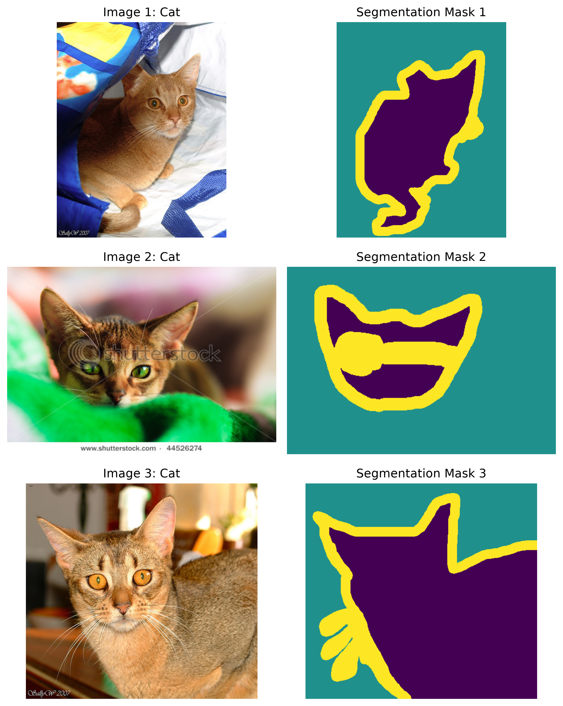
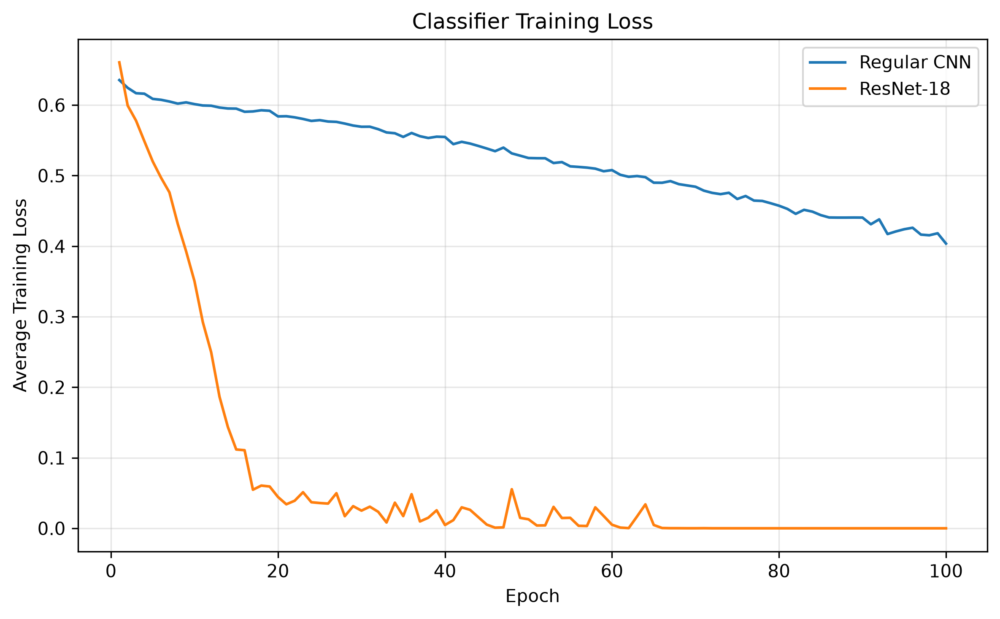
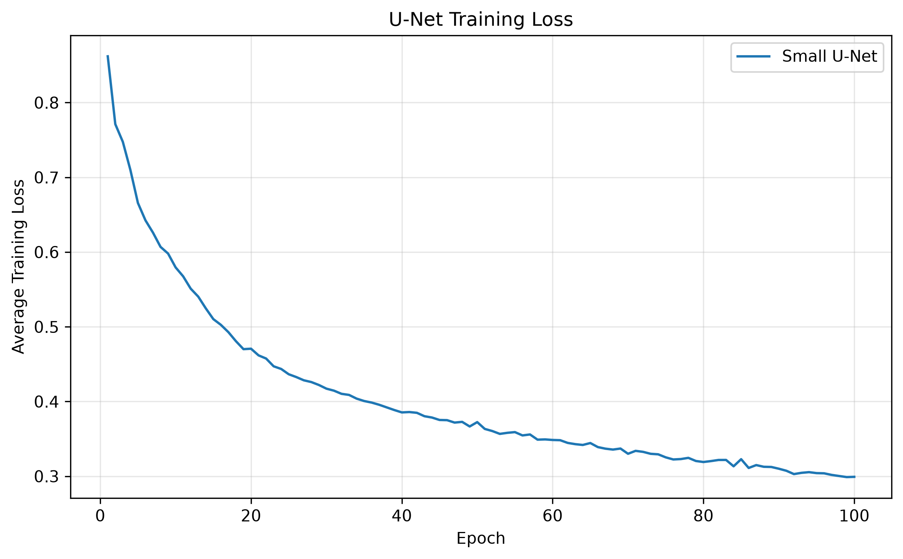
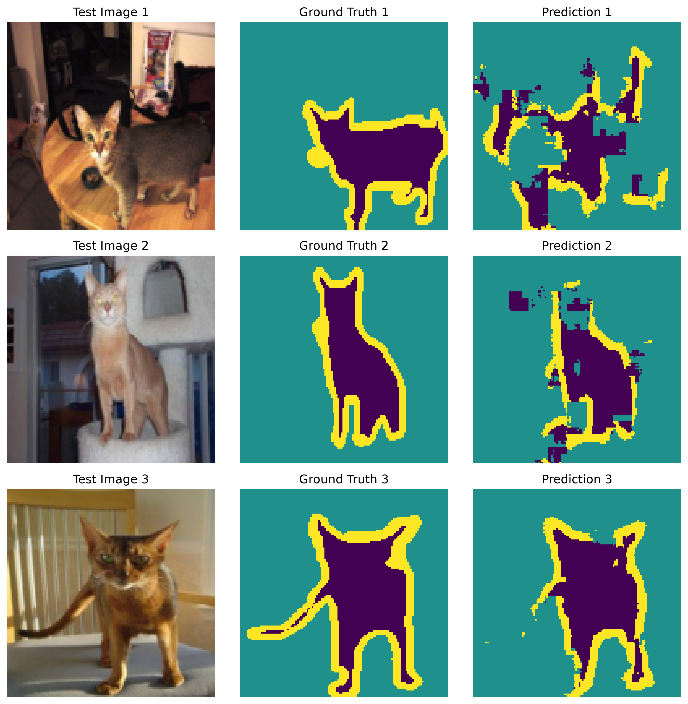

# Oxford-IIIT Pet Classification and Segmentation

## Environment

The project uses PyTorch and torchvision. The exact package versions are
listed in `requirements.txt`.

## Dataset Exploration

The Oxford-IIIT Pet dataset was loaded using the provided `data.py`.

- Training samples: 3680
- Testing samples: 3669
- First image dimensions (width, height): (394, 500)
- First image classification label: 0
- First mask dimensions (width, height): (394, 500)
- Raw mask values: [1 2 3]

The original images and masks can have different dimensions. PIL reports
these dimensions in `(width, height)` order.

## Sample Images and Segmentation Masks

The following figure shows the first three training images and their
corresponding segmentation masks.

figures/training_samples.png

## Processed Batch

A batch size of 16 was used.

- Images shape: `torch.Size([16, 3, 128, 128])`
- Labels shape: `torch.Size([16])`
- Masks shape: `torch.Size([16, 128, 128])`

The processed images are RGB images resized to 128 by 128 pixels. The labels
contain one cat-or-dog classification per image. The masks contain one of
three segmentation classes for each pixel.

## Model Architectures and Training Settings

All three models were trained from scratch with random seed 0. No pretrained
weights were used. Training was performed using an NVIDIA H100 NVL GPU.

The following training settings were used:

- Epochs: 100
- Batch size: 16
- Optimizer: Adam
- Learning rate: 0.001
- Loss function: Cross-entropy loss
- Image size: 128 × 128

The regular CNN used three convolutional layers with 16, 32, and 64 output
channels. Max pooling was applied after the first two convolutional layers.
Global average pooling reduced the final feature maps to 64 values, and a
linear layer produced two classification scores.

ResNet-18 was created using `torchvision.models.resnet18` with `weights=None`.
Its final fully connected layer was replaced with a layer that produces two
classification scores. All parameters were trained from scratch.

The small U-Net used two encoder levels with 16 and 32 channels, followed by
a 64-channel bottleneck. The decoder used transposed convolutions and skip
connections from the corresponding encoder levels. Its output layer produced
three scores per pixel for pet, background, and boundary.

## Model Evaluation

| Model | Evaluation Measure | Result |
|---|---|---:|
| Always-Dog baseline | Classification accuracy | 67.76% |
| Regular CNN | Classification accuracy | 75.44% |
| ResNet-18 | Classification accuracy | 81.28% |
| Small U-Net | Pixel accuracy | 84.05% |

Both classification models exceeded the always-Dog baseline. ResNet-18
achieved the highest classification accuracy, outperforming the regular CNN
by 5.84 percentage points.

The U-Net achieved a pixel accuracy of 84.05%. This result is not directly
comparable to the classifier accuracies because it measures the fraction of
correctly classified pixels rather than correctly classified images.
Segmentation examples are used separately to examine how well the model
identifies pets and their boundaries.


# Oxford-IIIT Pet Classification and Segmentation

## 1. Setup, Models, and Training

### Installation and Execution

Create and activate a Python virtual environment:

```bash
python3 -m venv assignment3-env
source assignment3-env/bin/activate
```

Install the required dependencies:

```bash
python -m pip install -r requirements.txt
```

Download and prepare the Oxford-IIIT Pet dataset using the instructor-provided script:

```bash
python data.py
```

Run the dataset exploration code:

```bash
python explore_data.py
```

Train and evaluate all three models:

```bash
python train_models.py
```

Generate the loss-curve and segmentation figures without retraining the models:

```bash
python analyze_results.py
```

### Hardware and Device Configuration

Training and evaluation were performed on an NVIDIA H100 NVL GPU. The program checked GPU availability with `torch.cuda.is_available()` and selected the device with `torch.device("cuda" if torch.cuda.is_available() else "cpu")`.

The final run reported:

```text
CUDA available: True
Selected device: cuda
GPU: NVIDIA H100 NVL
```

Each model was moved to the GPU with `model.to(device)`. During classification, the image tensors and cat-or-dog labels were moved to the same device. During segmentation, the image tensors and pixel masks were moved to the same device. This was necessary because PyTorch operations cannot directly combine tensors and model parameters located on different devices.

### Reproducibility and Training Settings

All models were trained from scratch. ResNet-18 used `weights=None`, so no pretrained ImageNet parameters were loaded.

- Random seed: `0`
- Epochs: `100`
- Batch size: `16`
- Optimizer: Adam
- Learning rate: `0.001`
- Loss function: `nn.CrossEntropyLoss()`
- Processed image size: `128 × 128`
- Classification classes: `0 = Cat`, `1 = Dog`
- Segmentation classes: `0 = Pet`, `1 = Background`, `2 = Boundary`

The regular CNN and ResNet-18 used the same optimizer, learning rate, batch size, number of epochs, training images, and testing images. This gave the classifiers comparable training budgets. U-Net used the same number of epochs and optimizer settings but solved a different task with pixel-level masks as targets.

Raw model scores were passed directly to `CrossEntropyLoss`. Softmax was not applied before the loss because cross-entropy expects unnormalized logits.

### Regular CNN Architecture

The regular CNN contains three convolutional layers. The first convolution converts the three RGB channels into 16 feature maps. The second increases the channel count from 16 to 32, and the third increases it from 32 to 64. All convolutions use a `3 × 3` kernel and padding of 1, which preserves height and width before pooling.

A ReLU activation follows each convolution. Max pooling after the first two convolutional stages reduces the spatial resolution from `128 × 128` to `64 × 64`, and then to `32 × 32`. Adaptive average pooling reduces every final feature map to one value. The resulting 64 values are flattened and passed to a linear layer that produces two classification logits.

```text
Input                         [B, 3, 128, 128]
Conv2d(3, 16) + ReLU          [B, 16, 128, 128]
MaxPool2d(2)                  [B, 16, 64, 64]
Conv2d(16, 32) + ReLU         [B, 32, 64, 64]
MaxPool2d(2)                  [B, 32, 32, 32]
Conv2d(32, 64) + ReLU         [B, 64, 32, 32]
AdaptiveAvgPool2d((1, 1))     [B, 64, 1, 1]
Flatten                       [B, 64]
Linear(64, 2)                 [B, 2]
```

Global average pooling keeps the classifier relatively small because it avoids connecting every `32 × 32` spatial location to a large fully connected layer. However, this small architecture also has less representational capacity than ResNet-18.

### ResNet-18 Architecture

ResNet-18 was created with `torchvision.models.resnet18(weights=None)`. Its original fully connected output layer was replaced before creating the optimizer:

```python
model.fc = nn.Linear(model.fc.in_features, 2)
```

The replacement changes the output from the original number of classes to two logits, one for cat and one for dog. All parameters remained trainable. Unlike the regular CNN, ResNet-18 contains multiple residual blocks. Its skip connections allow a block to learn a residual transformation while also preserving a direct path for information and gradients. In this experiment, the deeper residual network had substantially more capacity than the three-convolution CNN.

### Small U-Net Architecture

The U-Net performs semantic segmentation rather than whole-image classification. Its output contains three logits at every `128 × 128` pixel location.

Each `DoubleConv` block contains two `3 × 3` convolutions with padding 1 and a ReLU after each convolution. The encoder saves feature maps before downsampling so that they can later be reused by the decoder.

```text
Input                                      [B, 3, 128, 128]
Encoder 1: DoubleConv(3, 16)               [B, 16, 128, 128]
MaxPool2d(2)                               [B, 16, 64, 64]
Encoder 2: DoubleConv(16, 32)              [B, 32, 64, 64]
MaxPool2d(2)                               [B, 32, 32, 32]
Bottleneck: DoubleConv(32, 64)             [B, 64, 32, 32]
Transpose convolution 64 → 32              [B, 32, 64, 64]
Concatenate with Encoder 2                 [B, 64, 64, 64]
Decoder 1: DoubleConv(64, 32)              [B, 32, 64, 64]
Transpose convolution 32 → 16              [B, 16, 128, 128]
Concatenate with Encoder 1                 [B, 32, 128, 128]
Decoder 2: DoubleConv(32, 16)              [B, 16, 128, 128]
Output convolution 16 → 3                  [B, 3, 128, 128]
```

The encoder captures increasingly abstract features while pooling reduces spatial resolution. The decoder restores the original resolution. The two encoder-to-decoder skip connections preserve higher-resolution location and edge information that could otherwise be lost during pooling. The final `1 × 1` convolution converts the 16 decoder features at each pixel into three class logits for pet, background, and boundary.

## 2. Results and Analysis

### Dataset Information

The Oxford-IIIT Pet dataset was downloaded and loaded with the provided `data.py` file.

- Training samples: `3680`
- Testing samples: `3669`
- First image dimensions: `(394, 500)`
- First image classification label: `0`
- First mask dimensions: `(394, 500)`
- First raw mask unique values: `[1, 2, 3]`


The raw images and masks are PIL objects and can have different original dimensions. PIL reports dimensions as `(width, height)`. For training and evaluation, `get_loaders(batch_size=16)` resizes images and masks to `128 × 128`. The images become floating-point RGB tensors, while the masks become integer class-index tensors with values 0, 1, and 2.

### Sample Training Images

The first three training images and their corresponding raw segmentation masks are shown below. A fixed colormap range was used so that a mask value has the same color in every example.



### Processed Batch and Model Output Shapes

One processed training batch produced these shapes:

```text
Images: torch.Size([16, 3, 128, 128])
Labels: torch.Size([16])
Masks: torch.Size([16, 128, 128])
```

The image tensor contains 16 RGB images. The label tensor contains one cat-or-dog target for every image. The mask tensor contains one pet, background, or boundary target for each pixel.

Before training, the same image batch was passed through all three models:

```text
Regular CNN: torch.Size([16, 2])
ResNet-18:   torch.Size([16, 2])
Small U-Net: torch.Size([16, 3, 128, 128])
```

The two classifier outputs have two logits per image. The U-Net output has three logits per pixel and preserves the input height and width.

### Classification Accuracy

| Model | Test classification accuracy | Difference from baseline |
|---|---:|---:|
| Always-Dog baseline | 67.76% | 0.00 percentage points |
| Regular CNN | 75.44% | +7.68 percentage points |
| ResNet-18 | 81.28% | +13.52 percentage points |

ResNet-18 was the better classifier in this experiment. Its test accuracy was 81.28%, compared with 75.44% for the regular CNN, so it performed better by **5.84 percentage points**.

Both learned classifiers performed better than the always-Dog baseline. The baseline achieved 67.76% because 67.76% of the test labels were dogs. The regular CNN improved on this baseline by 7.68 percentage points. ResNet-18 improved on it by 13.52 percentage points. These improvements show that both models learned visual information beyond simply predicting the more common test class.

The more complex model did perform better in this run. ResNet-18's deeper residual architecture produced a 5.84-point accuracy improvement over the smaller CNN. However, the training results also show a trade-off: ResNet-18 fit the training set almost perfectly, while its test accuracy remained 81.28%. Therefore, the additional model capacity improved test accuracy but also increased the gap between training and testing performance.

### U-Net Pixel Accuracy

The trained U-Net achieved a test pixel accuracy of **84.05%**.

This means that 84.05% of all evaluated test pixels received the same class index as the ground-truth mask. Pixel accuracy is useful for measuring overall agreement, but it can be influenced by large background regions. A model can classify much of the background correctly while still producing imprecise pet edges or missing small pet regions. For this reason, the segmentation visualization below is needed to interpret the numerical score.

The 84.05% pixel accuracy should not be ranked directly against the CNN and ResNet-18 accuracies. Classification accuracy counts correct images, whereas U-Net pixel accuracy counts correct pixels. The models also predict different target types: cat or dog for classification, and pet, background, or boundary for segmentation.

### Classification Training-Loss Analysis



The regular CNN loss decreased from **0.6355 at epoch 1** to **0.4037 at epoch 100**, a total reduction of 0.2318. Its curve declined gradually rather than collapsing quickly. There were small temporary increases, such as the changes around epochs 35 through 40 and several later epochs, but the long-term direction remained downward. The final ten epochs still moved between approximately 0.4380 and 0.4037, so the CNN had not reached a completely flat plateau by epoch 100. This suggests that its limited architecture was continuing to learn, although improvements had become slower.

ResNet-18 loss decreased from **0.6606 at epoch 1** to a value displayed as **0.0000 by epoch 72 and afterward**. Its loss fell below 0.30 by epoch 11, below 0.10 by epoch 17, and below 0.01 at several points beginning around epoch 33. There were noticeable spikes after some low-loss epochs, including 0.0554 at epoch 48 and 0.0339 at epoch 64. These fluctuations likely reflect batch ordering and Adam updates, but the model repeatedly returned to very low loss and eventually leveled off near zero.

The curves show that ResNet-18 optimized the training set much more aggressively than the regular CNN. ResNet-18's near-zero final training loss indicates that it could almost perfectly separate the training images. Its test accuracy of 81.28% was substantially lower than this near-perfect training behavior, which is evidence of overfitting. The regular CNN retained a much higher training loss but still reached 75.44% test accuracy. Thus, ResNet-18's greater capacity improved test accuracy by 5.84 points, but not in proportion to how much more closely it fit the training set.

Only training loss was recorded, so the exact epoch at which test or validation performance peaked cannot be determined from these curves. The near-zero ResNet training loss is therefore a warning sign rather than proof that a particular earlier epoch would have produced better test accuracy.

### U-Net Training-Loss Analysis



The U-Net loss decreased from **0.8619 at epoch 1** to **0.2992 at epoch 100**, a total reduction of 0.5627. The largest reduction occurred early: the loss reached 0.5795 by epoch 10 and 0.4707 by epoch 20. After that, improvement became more gradual, reaching 0.3854 at epoch 40, 0.3485 at epoch 60, and 0.3190 at epoch 80.

The curve includes short fluctuations rather than decreasing on every individual epoch. Examples include the increase from 0.3666 at epoch 49 to 0.3724 at epoch 50 and the increase from 0.3133 at epoch 84 to 0.3228 at epoch 85. These increases were temporary. By the final epochs, the loss returned to approximately 0.30, and the overall trend remained downward.

The later part of the curve is flatter than the first 20 epochs, which indicates diminishing improvement rather than complete stagnation. The change from 0.3485 at epoch 60 to 0.2992 at epoch 100 shows that the final 40 epochs still reduced the loss by about 0.0493. The curve therefore suggests rapid learning of broad pet and background regions early in training, followed by slower refinement of harder pixels, likely including boundaries and detailed shapes.

U-Net's numerical loss is shown separately because its loss is computed across three pixel classes at every spatial location. It should not be directly compared with the classifier loss values, which are computed from one cat-or-dog target per image.

### Segmentation Examples



The first column contains the original test images, the second contains the ground-truth masks, and the third contains the U-Net predictions. Both mask columns use the same colormap with `vmin=0` and `vmax=2`, so each class is represented consistently.

The predictions should be interpreted in terms of three features: the main pet region, separation from the background, and boundary precision. The U-Net's 84.05% pixel accuracy indicates strong overall agreement, but the visual masks show whether that agreement includes the animal itself rather than only the larger background area.

**Before submission, replace this paragraph with observations from the displayed figure.** State specifically which of the three examples captures the pet silhouette most accurately, which example has the largest incorrect region, and whether errors occur around ears, legs, fur, thin boundaries, or nearby background objects. Avoid claiming that all predictions are strong unless the figure supports that statement.

A detailed final paragraph can follow this structure:

> In the first example, the predicted mask **[describe the visible match or error]**. In the second example, the model **[describe the visible match or error]**. The third example shows **[describe the visible match or error]**. Across the three images, the model **[does/does not]** preserve the pets' overall silhouettes. The most consistent differences from the ground truth occur **[identify visible locations]**. These errors help explain why pixel accuracy is 84.05% rather than perfect.

Segmentation reveals information that classification cannot provide. The CNN and ResNet-18 return only a cat-or-dog decision for the complete image, so they do not indicate where the animal is located or which pixels influenced the decision. U-Net identifies the spatial extent of the pet, separates it from the background, and attempts to mark its boundary. This makes segmentation useful for evaluating shape and localization errors that remain invisible in whole-image accuracy.

### Training Time

The measured training times were:

- Regular CNN: `18.83 minutes`
- ResNet-18: `27.30 minutes`
- Small U-Net: `21.22 minutes`
- Total model-training time: approximately `67.35 minutes`

ResNet-18 took the longest because it contains a deeper sequence of residual blocks and performs more operations per image than the regular CNN. U-Net also performs dense pixel-level prediction and maintains high-resolution decoder features, but its small channel configuration kept its measured training time below ResNet-18 in this run.

### Saved Outputs

The completed experiment produced:

```text
cnn_model.pth
resnet18_model.pth
unet_model.pth
training_results.pth
figures/training_samples.png
figures/classification_training_loss.png
figures/unet_training_loss.png
figures/segmentation_results.png
```

The three model files contain final trained parameters. `training_results.pth` stores the loss histories, evaluation values, predictions, test labels, random seed, batch size, learning rate, and epoch count. The analysis script loaded these saved outputs, confirmed that each loss history contained 100 epochs, and generated all three analysis figures successfully.

### Generative AI Acknowledgment

I used Microsoft 365 Copilot, based on the GPT-5 reasoning model, to help interpret the assignment requirements, structure portions of the PyTorch model, training, evaluation, and plotting code, debug implementation and environment errors, and organize portions of this README. I reviewed and tested the code, downloaded and explored the assigned dataset, trained the models, generated the figures, and based the reported measurements and interpretations on my actual experiment outputs.
