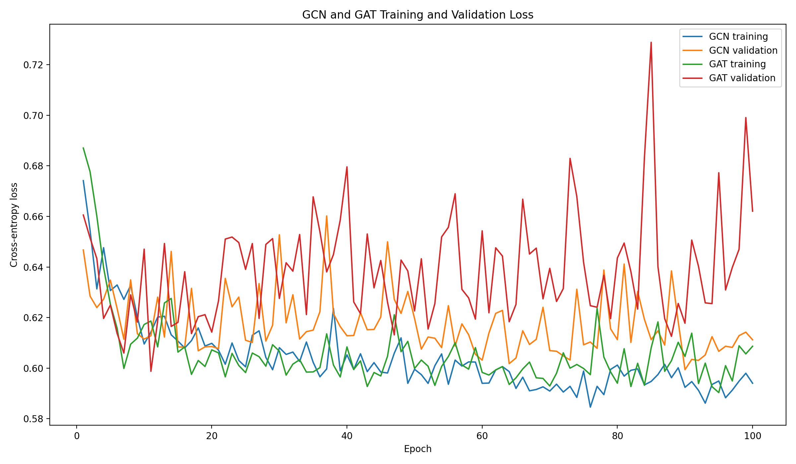

# Homework 6: Graph Classification on the PROTEINS Dataset

## Generative AI Acknowledgment

Microsoft Copilot powered by GPT-5.6 was used to help generate, organize, debug, format, and review the Python code and written explanations for this assignment. Specifically, Copilot assisted with structuring the PyTorch Geometric workflow, reviewing the GCN and GAT implementations, organizing the validation-based checkpoint procedure, improving code readability, and converting the observed program output into this report. I ran the code in my own environment, reviewed the generated content, and verified the reported output.

## Repository Organization

This assignment is stored in the `homework6` folder at the root of the existing course repository.

```text
CSCI-4425-M01-Hunter-M.../
├── assignment1/
├── assignment2/
├── assignment5/
├── homework6/
│   ├── data/
│   ├── gat_best.pt
│   ├── gcn_best.pt
│   ├── hw6.py
│   ├── loss_curves.png
│   ├── README.md
│   └── requirements.txt
└── .gitignore
```

The required `hw6.py` and `README.md` files are stored directly inside `homework6`. The `loss_curves.png` file contains the training and validation loss plot used in this report, and `requirements.txt` records the project dependencies.

The `data` directory contains the downloaded PyTorch Geometric dataset. The `gcn_best.pt` and `gat_best.pt` files contain the model checkpoints selected using validation loss. These files are useful locally but do not need to be committed because the dataset and checkpoints can be regenerated by running `hw6.py`.

The repository-level `.gitignore` is located at the top level beside `homework6`, `assignment1`, `assignment2`, `assignment5`, and `group`.


## Installation and Execution

The following commands create and activate the required Conda environment and install the necessary packages:

```bash
conda create -n env_csci4425 python=3.12
conda activate env_csci4425
conda install numpy matplotlib scikit-learn
conda install pytorch torchvision torchaudio -c pytorch
pip install torch-geometric
```

If `env_csci4425` already exists, it does not need to be recreated. Activate the existing environment and install or update the required packages:

```bash
conda activate env_csci4425
conda install numpy matplotlib scikit-learn
conda install pytorch torchvision torchaudio -c pytorch
pip install torch-geometric
```

From the repository root, run the assignment with:

```bash
cd homework6
conda activate env_csci4425
python hw6.py
```

The first execution downloads and processes the PROTEINS dataset. The program then:

1. Loads and explores the dataset.
2. Splits the graphs into training, validation, and test sets.
3. Creates graph mini-batches.
4. Trains the GCN model.
5. Trains the GAT model.
6. Retains each model checkpoint with the lowest validation loss.
7. Evaluates the selected checkpoints on the held-out test set.
8. Generates `loss_curves.png`.

---

## Part 1: Data Loading and Exploration

The PROTEINS dataset was loaded using `TUDataset` from PyTorch Geometric.

### General Dataset Information

| Property | Value |
|---|---:|
| Total number of graphs | 1,113 |
| Number of graph classes | 2 |
| Number of node features | 3 |
| Average number of nodes per graph | 39.0575 |

The dataset contains protein graphs for a binary graph-classification task. Nodes represent secondary structure elements, and edges indicate structural or sequential proximity between those elements.

### First Graph

The first graph was represented by the following PyTorch Geometric data object:

```text
Data(edge_index=[2, 162], x=[42, 3], y=[1])
```

This representation reports that the first graph contains 42 nodes, three features per node, 162 entries in the edge-index representation, and one graph-level target label.

The node-feature matrix had the following shape:

```text
torch.Size([42, 3])
```

Each of the 42 rows represents one node, and each row contains three feature values. The displayed vectors are one-hot encoded. For example, `[1, 0, 0]` and `[0, 1, 0]` identify different node-feature categories.

The edge-index matrix had the following shape:

```text
torch.Size([2, 162])
```

Each column describes one edge entry. The first row contains source-node indices, and the second row contains the corresponding destination-node indices. PyTorch Geometric commonly represents an undirected connection using entries in both directions, so a connection between two nodes may appear as both `i -> j` and `j -> i`.

The graph label was:

```text
tensor([0])
```

Therefore, the first graph belongs to class 0. The `y=[1]` text shown inside the `Data` summary describes the shape of the label tensor, meaning that the tensor contains one value. It does not mean that the label value itself is class 1.

### Average Number of Nodes

The average number of nodes per graph was calculated across all 1,113 graphs:

```text
Average number of nodes per graph: 39.0575
```

This indicates that a typical PROTEINS graph contains approximately 39 secondary structure elements, although individual graphs can contain more or fewer nodes.

---

## Part 2: Data Preprocessing

### Training, Validation, and Test Split

The graphs were divided at the graph level so that no graph appeared in more than one subset. The split used:

```text
random_state = 0
```

First, 20% of the complete dataset was reserved for testing. Then, 12.5% of the remaining 80% was assigned to validation. Because 12.5% of 80% equals 10% of the complete dataset, this procedure produced the requested approximate 70% training, 10% validation, and 20% test allocation.

Stratification was used to preserve the class distribution as closely as possible across the three subsets.

| Dataset subset | Number of graphs | Actual percentage |
|---|---:|---:|
| Training | 778 | 69.90% |
| Validation | 112 | 10.06% |
| Test | 223 | 20.04% |
| **Total** | **1,113** | **100.00%** |

The percentages differ slightly from exactly 70%, 10%, and 20% because the dataset must be divided into whole graphs.

The training set was used to update model parameters. The validation set was used to select the best checkpoint for each model. The test set was reserved for final evaluation and was not used to select epochs, tune hyperparameters, or update model weights.

### Mini-Batches

PyTorch Geometric's `DataLoader` created mini-batches with a batch size of 32. Training mini-batches were shuffled. Validation and test mini-batches were not shuffled.

One example training mini-batch had the following dimensions:

```text
x:          torch.Size([1227, 3])
edge_index: torch.Size([2, 4374])
batch:      torch.Size([1227])
y:          torch.Size([32])
```

The mini-batch contained 32 protein graphs and 1,227 nodes in total.

- `x` combines the node-feature matrices of all graphs in the mini-batch.
- `edge_index` contains the connectivity information for the batched graphs.
- `batch` maps each of the 1,227 nodes back to the graph to which the node belongs.
- `y` contains one graph-level class label for each of the 32 graphs.

The `batch` vector is required for graph-level pooling. It allows `global_mean_pool` to compute a separate representation for each graph rather than averaging all nodes from all 32 graphs together.

---

## Part 3: Model Building and Training

Both models were trained for 100 epochs using the same training, validation, and test split.

| Hyperparameter | Value |
|---|---:|
| Hidden channels | 64 |
| Dropout probability | 0.5 |
| Batch size | 32 |
| Learning rate | 0.01 |
| Maximum epochs | 100 |
| Optimizer | Adam |
| Loss function | Cross-entropy loss |
| Random seed | 0 |

### Graph Convolutional Network

The GCN model contained two graph convolution layers and one final output layer:

1. `GCNConv(3, 64)`
2. ReLU activation
3. Dropout with probability 0.5
4. `GCNConv(64, 64)`
5. ReLU activation
6. Global mean pooling
7. `Linear(64, 2)`

The graph convolution layers generated a learned representation for every node. Global mean pooling averaged the node representations separately for each graph, producing one 64-dimensional graph representation. The final linear layer converted each graph representation into two class scores.

### Graph Attention Network

The GAT model used graph attention layers:

1. `GATConv(3, 64, heads=4)`
2. ELU activation
3. Dropout with probability 0.5
4. `GATConv(256, 64, heads=1, concat=False)`
5. ELU activation
6. Global mean pooling
7. `Linear(64, 2)`

The first layer used four attention heads. Each head produced 64 features, so concatenating the four heads created 256 features per node. The second attention layer converted the 256-dimensional representation back to 64 features. Setting `concat=False` prevented the second layer from concatenating its output. Global mean pooling then created one graph-level representation for each protein graph.

### Training Procedure

For each training mini-batch, the model performed a forward pass using `x`, `edge_index`, and `batch`. Cross-entropy loss compared the two output scores with the graph labels. Backpropagation calculated gradients, and Adam updated the model parameters.

At the end of every epoch, the model was switched to evaluation mode and validation loss was calculated without gradients. A deep copy of the model parameters was retained whenever validation loss reached a new minimum.

This procedure separates parameter learning from model selection:

- Training data determined parameter updates.
- Validation data selected the checkpoint.
- Test data measured final performance only after selection was complete.

### Checkpoint Selection

| Model | Best validation epoch | Lowest validation loss |
|---|---:|---:|
| GCN | 90 | 0.5994 |
| GAT | 11 | 0.5987 |

The GCN reached its minimum validation loss relatively late at epoch 90. The GAT reached its minimum validation loss much earlier at epoch 11.

The GAT's minimum validation loss was slightly lower than the GCN's minimum:

```text
0.5994 - 0.5987 = 0.0007
```

The difference of approximately 0.0007 is very small. Therefore, the more meaningful distinctions are the stability of the validation curves and the final held-out test performance.

The generated `gcn_best.pt` and `gat_best.pt` files contain the selected model checkpoints. The final test evaluation used the validation-selected model states rather than automatically using the epoch-100 states.

---

## Part 4: Final Test-Set Evaluation

The selected GCN and GAT checkpoints were evaluated on the held-out test set containing 223 graphs. For each graph, the model produced two class scores. `argmax(dim=1)` selected the class with the largest score.

Class 1 was treated as the positive class when calculating precision, recall, and F1-score.

| Model | Accuracy | Precision | Recall | F1-score |
|---|---:|---:|---:|---:|
| GCN | 0.7130 | 0.6806 | 0.5444 | 0.6049 |
| GAT | 0.7040 | 0.6714 | 0.5222 | 0.5875 |

### Accuracy

The GCN achieved an accuracy of 0.7130, meaning that approximately 71.30% of the 223 test graphs were classified correctly. The GAT achieved an accuracy of 0.7040, meaning that approximately 70.40% were classified correctly.

The GCN accuracy was approximately 0.0090, or 0.90 percentage points, higher than the GAT accuracy.

### Precision

The GCN achieved a precision of 0.6806. Among the graphs predicted as class 1 by the GCN, approximately 68.06% actually belonged to class 1.

The GAT achieved a precision of 0.6714. Among the graphs predicted as class 1 by the GAT, approximately 67.14% actually belonged to class 1.

The GCN therefore had a slightly better positive predictive value and produced slightly fewer false-positive class-1 predictions relative to its total positive predictions.

### Recall

The GCN achieved a recall of 0.5444, meaning that the GCN correctly identified approximately 54.44% of the actual class-1 graphs.

The GAT achieved a recall of 0.5222, meaning that the GAT correctly identified approximately 52.22% of the actual class-1 graphs.

Recall was the lowest metric for both models. This indicates that both models missed a substantial portion of the actual class-1 graphs and predicted class 0 for those examples.

### F1-Score

The GCN achieved an F1-score of 0.6049, while the GAT achieved an F1-score of 0.5875. The F1-score combines precision and recall using their harmonic mean. The GCN's higher F1-score indicates a better balance between correctly detecting class-1 graphs and limiting false-positive class-1 predictions.

### Overall Test Performance

The GCN performed better than the GAT on every reported test metric:

- Accuracy was higher by approximately 0.0090.
- Precision was higher by approximately 0.0091.
- Recall was higher by approximately 0.0222.
- F1-score was higher by approximately 0.0174.

The differences were modest, but the result was consistent across all four metrics. Therefore, the GCN was the stronger model on this held-out test set.

The test results were not used to modify the architectures, choose epochs, tune hyperparameters, or retrain either model. Each checkpoint had already been selected using validation loss.

---

## Part 5: Loss Curves and Interpretation



The figure contains four curves:

- Blue: GCN training loss
- Orange: GCN validation loss
- Green: GAT training loss
- Red: GAT validation loss

### GCN Training and Validation Loss

The GCN training loss decreased rapidly during the first several epochs. The curve began near 0.67 and moved toward approximately 0.61 during the early training period. After the initial decrease, training loss improved more gradually and generally remained between approximately 0.59 and 0.61.

At epoch 100, the GCN training loss was:

```text
0.5940
```

The GCN validation loss also decreased early in training. After the initial improvement, the validation curve fluctuated mostly between approximately 0.60 and 0.65. Its lowest recorded value was:

```text
0.5994 at epoch 90
```

At epoch 100, the validation loss was:

```text
0.6112
```

Because the epoch-100 validation loss was higher than the minimum at epoch 90, the epoch-90 checkpoint was the proper GCN checkpoint for final testing.

The GCN validation curve was noisier than the GCN training curve, which is expected because the validation set contained only 112 graphs and did not directly influence parameter updates. The later training loss was usually below validation loss, creating a modest generalization gap. However, the GCN does not show severe or continuously worsening overfitting because it continued to obtain validation improvements late in training and reached its best validation value at epoch 90.

### GAT Training and Validation Loss

The GAT training loss began near 0.69 and decreased sharply during the first several epochs. It then stabilized mostly between approximately 0.59 and 0.61.

At epoch 100, the GAT training loss was:

```text
0.6086
```

The GAT validation curve initially decreased and reached its minimum at epoch 11:

```text
0.5987 at epoch 11
```

After epoch 11, the validation loss became substantially more variable. The red curve repeatedly moved into the approximate 0.63 to 0.68 range and contained several pronounced spikes. The largest visible spike occurred around epoch 85 and reached approximately 0.73. Another large spike occurred near epoch 99 and approached 0.70.

At epoch 100, the GAT validation loss was:

```text
0.6621
```

The epoch-100 validation loss was far above the minimum obtained at epoch 11. Therefore, using the final epoch would have discarded the model state that generalized best to validation data. Retaining the epoch-11 checkpoint prevented the unstable later epochs from replacing the better checkpoint.

### Training Stability

The GCN trained more steadily than the GAT. Both training curves were relatively stable after their early decreases, but their validation behavior differed.

The GCN validation loss fluctuated within a comparatively narrower range. The GAT validation loss showed larger and more frequent jumps, particularly during the second half of training. The GAT therefore had less stable validation behavior.

One possible reason is that the GAT has a more flexible attention mechanism. The four attention heads learn different weights for neighboring nodes, which adds model complexity. On this dataset and split, that flexibility did not produce better test performance and may have made the model more sensitive to parameter updates.

The validation set also contained only 112 graphs. With a relatively small validation set, a few difficult graphs can noticeably affect the mean validation loss. This limitation can contribute to noise in both validation curves, although the effect was visibly stronger for the GAT.

### Overfitting Analysis

The GCN shows limited or mild signs of overfitting. Its training loss gradually decreased while its validation loss fluctuated, but the validation loss still reached its best value at epoch 90. This means later training was not uniformly harmful, and the train-validation separation remained moderate.

The GAT shows clearer evidence of overfitting and unstable generalization after epoch 11. Its training loss remained relatively low while validation loss frequently increased and became volatile. The growing separation between the stable training curve and the unstable validation curve indicates that later improvements on training batches did not consistently transfer to unseen validation graphs.

### Final Comparison

The GAT achieved the slightly lower minimum validation loss:

```text
GAT minimum validation loss: 0.5987
GCN minimum validation loss: 0.5994
```

However, the difference was only approximately 0.0007 and did not lead to better held-out test performance.

The GCN:

- Trained more steadily.
- Produced a less volatile validation curve.
- Achieved higher test accuracy.
- Achieved higher test precision.
- Achieved higher test recall.
- Achieved a higher test F1-score.

Therefore, the GCN provided the best overall result for this graph-classification task under the fixed split and training configuration. The GAT remained competitive, but its validation behavior was less stable and its selected checkpoint produced slightly weaker test results.

---

## Submission Files

The assignment is organized in the root-level `homework6` folder:

```text
homework6/
├── hw6.py
├── README.md
├── loss_curves.png
└── requirements.txt
```

The required submission files are `hw6.py` and `README.md`. The `loss_curves.png` file is included because the README embeds the training and validation loss figure. The `requirements.txt` file records the package dependencies.

The downloaded `data` directory and the generated `gcn_best.pt` and `gat_best.pt` checkpoint files are useful locally but are excluded from GitHub because the dataset can be downloaded again and the checkpoints can be regenerated by running `hw6.py`.
